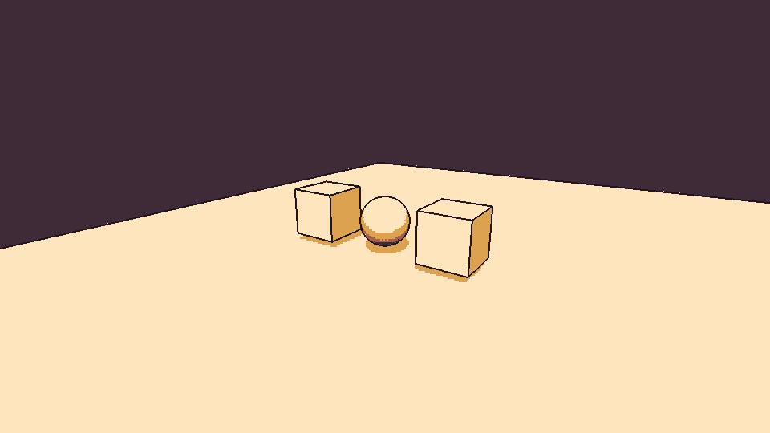
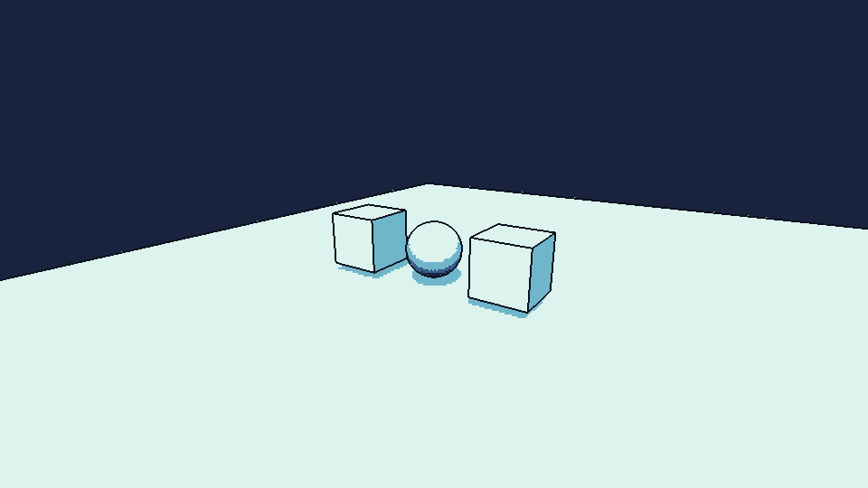
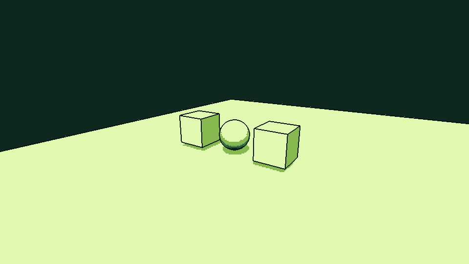
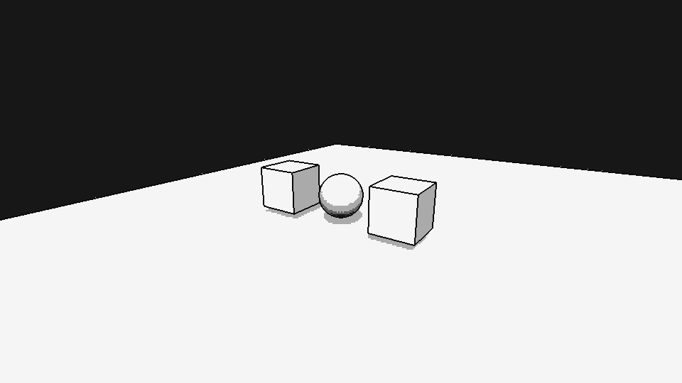
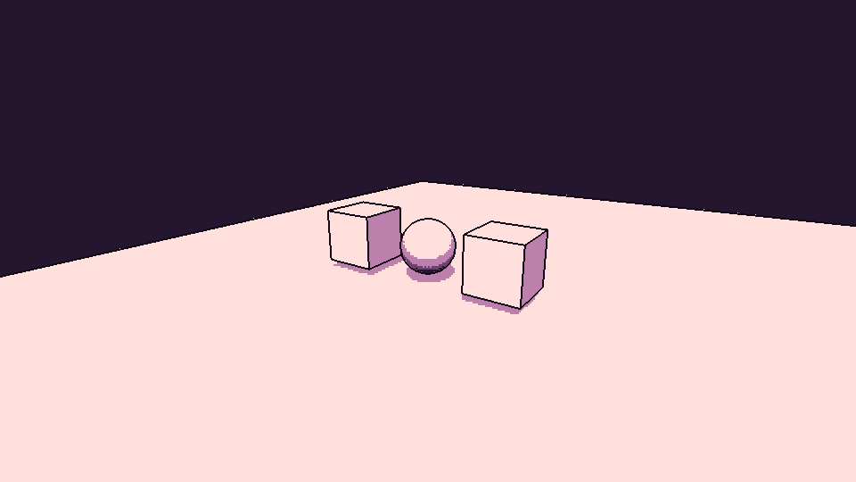

# PocketPixel 1.0.1

**English** | [Deutsch](README.de.md)

A global four-colour pixel filter for Unity 6 URP 3D, using the Universal Renderer.

Developed and tested with Unity 6000.4.0f1 and URP 17.4.0 using the Universal Renderer.
The Built-in Render Pipeline, HDRP and URP 2D Renderer are not supported. Other versions have not been tested.

## Previews

| Warm yellow | Ice blue |
| --- | --- |
|  |  |
| Green | Black and white |
|  |  |
| Violet | |
|  | |

## Download

**[Download PocketPixel 1.0.1 for Unity (.unitypackage)](https://github.com/MinmaxCH/PocketPixel/raw/refs/heads/main/PocketPixel-1.0.1.unitypackage)**

[Download the complete package with source code, previews and documentation (.zip)](https://github.com/MinmaxCH/PocketPixel/raw/refs/heads/main/PocketPixel-1.0.1-komplett.zip)

This repository is private. Downloads require a GitHub account with access.

## Installation in a new project

1. Open a Universal 3D project (URP).
2. Import `PocketPixel-1.0.1.unitypackage` via **Assets > Import Package > Custom Package**.
3. Wait for compilation to finish. Renderer integration is configured automatically.
4. Drag `Assets/PocketPixel/Pixel Filter.prefab` into the Hierarchy.
5. Select the object to access all controls in the Inspector.

Alternatively, use **GameObject > Effects > Pixel Filter** to create a filter object.
If you change the render pipeline later, use **Tools > Pixel Filter > Installieren oder reparieren** (Install or repair).
Setup only modifies the renderers referenced by the URP assets used in Graphics and Quality Settings.

The custom Inspector and menu labels are currently in German.

## Global filter behaviour

- No active filter object: no effect.
- Disable the object or its Pixel Filter component to turn the effect off.
- Position, rotation and scale do not affect the filter; it applies globally.
- There are no spatial bounds, entry zones or volume-boundary blends.
- With multiple filter objects, the highest priority wins. Avoid equal priorities.
- The effect applies across loaded scenes. Scene view preview can be disabled separately.
- Camera stacks are filtered at the final camera. Screen Space - Overlay UI remains unfiltered.
- Preview objects in Prefab Mode do not act as scene filters.

## Presets and custom colours

The available palettes are warm yellow (Warmgelb), green (Gruen), ice blue (Eisblau), violet (Violett) and black and white (Schwarzweiss).
The default warm-yellow prefab is in the PocketPixel folder. Additional preset prefabs are in its Prefabs subfolder.
All palettes can also be selected in the Inspector under **Farbvorlage**.

Applying a preset changes only the four palette colours and the outline colour, leaving pixel size and exposure unchanged.
Colours can be edited freely afterwards. **Farbvorlage erneut anwenden** reapplies the preset colours.
**Alle Filterwerte zurücksetzen** restores the warm-yellow palette and default effect settings.

To create a custom preset, drag a configured object from the Hierarchy into your own Project folder.
Settings are stored per object; changing one object does not modify a shared material.

## Controls

- **Vertical pixel count:** lower values produce larger blocks. Actual pixel size depends on the output resolution.
- **Exposure / contrast:** control the mapping to four brightness levels.
- **Dithering:** adds patterned transitions between colours.
- **Outlines:** detect depth and surface-normal edges independently of surface colour.
- **Outline width:** accepts fractional values from 0 to 4 in filter pixels, such as 0.25. Lines thinner than one screen pixel are attenuated.
- Transparent materials without depth/normal passes do not receive reliable outlines.

## Implementation and limitations

Setup adds a custom URP Renderer Feature. When no filter object is active, the feature does not enqueue its filter pass.
The material is created internally on demand, reused and released when the feature is disposed.
A shader reference is stored in the renderer feature so the shader can be included in builds.

The filter pixelates the rendered image; it does not reduce the internal 3D rendering resolution.
URP may require additional colour-copy or depth/normal passes, so one filter pass does not imply a single GPU operation for the entire effect.

The filter is intended for SDR desktop output. XR, HDR output and dynamic resolution have not been tested.
Subsequent antialiasing or upscaling may soften the pixels.

## Redistribution

Export only `Assets/PocketPixel` using **Assets > Export Package**.
Do not include project-specific scenes, pipeline assets, unrelated game objects or the Library folder.
The included Unity package is already assembled this way.

Additional platform testing and product documentation are required before a public asset-store release.

## Selecting the filter in the Scene view

Enable Scene Gizmos to see and select the four-colour pixel icon.
The icon remains invisible in the game and identifies the filter object; it does not represent spatial effect bounds.

## Licence and source code

Private and commercial use, modification and redistribution are permitted under the included licence.
Publicly distributed products incorporating PocketPixel must include **PocketPixel - minmax.ch** in their credits or acknowledgments, or in an accessible About screen or accompanying end-user documentation if they have no credits section.
See [LICENSE.txt](LICENSE.txt) for the complete terms. This is a custom attribution licence, not the unmodified MIT License.

All C# and shader source files are included.
[TECHNICAL.md](TECHNICAL.md) covers implementation and maintenance; [TROUBLESHOOTING.md](TROUBLESHOOTING.md) covers troubleshooting. These documents and the documentation bundled in the downloads are currently in German.
